# Maharashtra Iron Works: Inventory Management & Analytics

### QR-Based Inventory Website | Google Apps Script | Google Sheets | Python | MySQL | Power BI


## At a Glance

- **Problem:** A hardware shop tracked stock in paper registers, so stock counts were hard to trust, searching for items took time, and there was no record of who sold what.
- **Built:** A QR-based stock website (Google Apps Script + Google Sheets), MySQL scripts for validation and analysis, and a 5-page Power BI dashboard.
- **Data:** 300 real products from the shop's product sheet. The 1,296 transactions (May to early Oct 2026), cost prices and reorder levels used for analysis are **simulated**.

> **Data note:** Product names, prices and stock levels come from the shop's product sheet. The transaction history, cost prices and reorder levels used for analysis were generated with Python. Findings describe this simulated dataset, not the shop's real performance.

## Key Findings (simulated data)

1. **Stock out exceeds stock in.** 4,422 units went out against 3,856 received, a net draw-down of 566 units.
2. **Fast movers are small parts.** The top 10 products by units sold are washers, nuts, bolts, screws and cable lugs, led by Spring Washer M8.
3. **Units sold is not the same as revenue.** Fasteners move the most units but add little revenue, while Power Tools bring in about 46% of estimated revenue.
4. **Recommendation:** keep a higher minimum stock for fast-moving small parts so they never run out, protect stock of high-value categories like Power Tools, and review restock quantities so stock in keeps pace with stock out.

---

## 1. Business Problem

Managing inventory with manual registers creates problems:

- Difficulty checking available stock quickly
- Time-consuming stock additions and deductions
- Limited visibility of product details and rack locations
- Risk of manual recording errors
- No reliable transaction history
- No reporting or analytics

The goal was to build a simple digital workflow for the shop floor, and then show how the resulting data can support business decisions.

---

## 2. QR-Based Inventory Website

**Technologies:** HTML, CSS, JavaScript, Google Apps Script, Google Sheets

### Admin Interface
- Product list with images and details
- Search by product name, code, brand, category and rack
- Current stock with status indicators (available, low, out of stock)
- Add and remove stock
- Product QR code generation
- Responsive layout for desktop and mobile

### Worker QR Interface
Workers scan a product's QR code to open its page, where they can:
- See product details, price, rack and live stock
- Record a sale with their name
- Add stock

### How a stock update works
1. A user selects or scans a product.
2. Google Apps Script fetches the product record from Google Sheets.
3. The user enters a quantity and confirms.
4. The script validates it (whole number, greater than zero, and not more than the available stock for a sale).
5. The stock value in the sheet is updated, inside a lock so simultaneous updates cannot clash.
6. A transaction row is added with timestamp, product, type (IN or OUT), quantity, staff name and source.
7. The new stock value is shown on screen.

### Website Screenshots

**Admin Interface**


**Admin Stock Management**

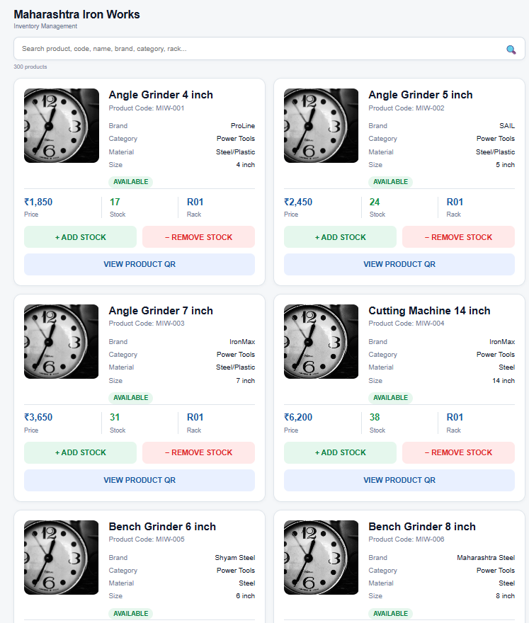

**Product QR Code**

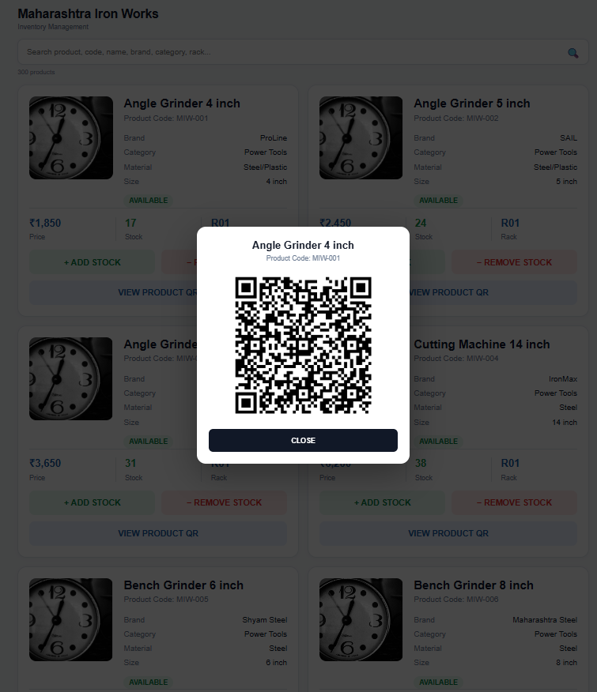

**Worker QR Workflow**

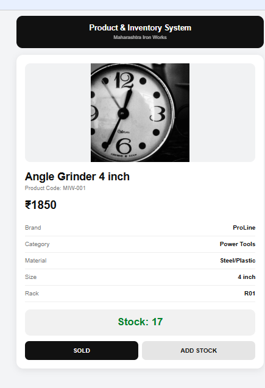

**Worker Interface**

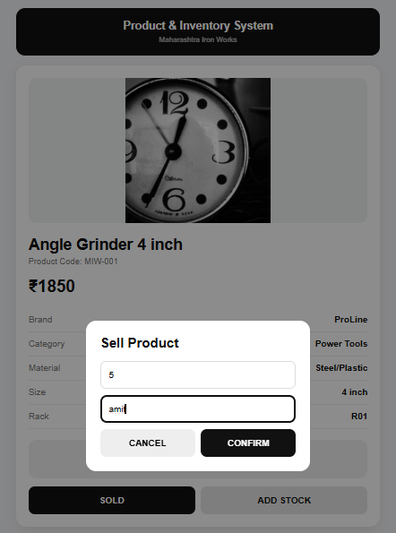

**Google Sheets Product Records**

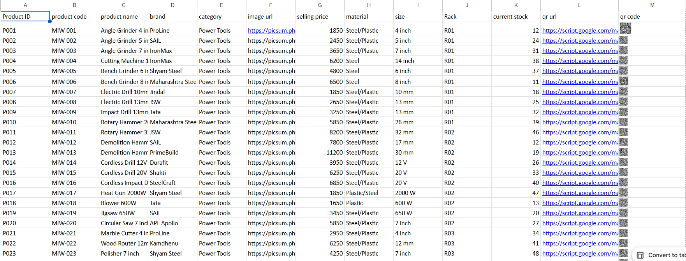

**Saved Transactions**

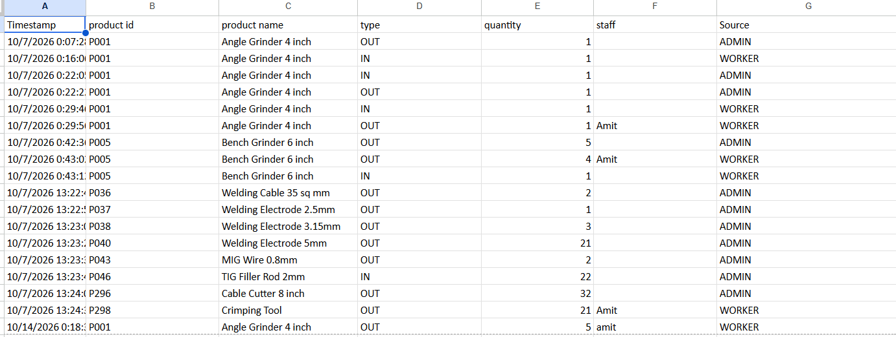

**Staff Name Recording**

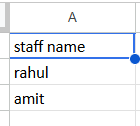

---

## 3. Google Sheets as the Data Store

**Product sheet:** product ID and code, name, brand, category, image, selling price, material, size, rack, current stock, QR link.

**Transaction sheet:** timestamp, product ID, product name, type, quantity, staff name (for sales) and source.

- **IN:** stock received or added
- **OUT:** stock sold or removed

---

## 4. Python: Transaction Data Generation

The shop's real transaction history was too short for analysis, so a Python script generates a realistic one.

- `make_simulated_data.py` builds `transactions.csv` and an enriched `products.csv`.
- The history covers May to early Oct 2026 with two staff members, Rahul and Amit. The shop is closed on Sundays, Saturdays are busiest, a few products sell most of the volume, some products never sell, and stock is replenished weekly.
- The script replays the history so the final stock of every product equals its current stock, and stock never goes negative.
- A fixed random seed makes the data reproducible.

This analytical dataset is separate from the live transaction records created by the website.

---

## 5. MySQL Database and SQL Analysis

**Technology:** MySQL

Product and transaction data were loaded into a relational database for validation and analysis.

| File | Purpose |
|---|---|
| `01_create_database_tables.sql` | Create database tables |
| `02_transaction_validation.sql` | Validate transaction data |
| `03_data_quality_summary.sql` | Summarize data quality |
| `04_transaction_date_range.sql` | Check transaction date coverage |
| `05_product_count.sql` | Count products |
| `06_show_tables.sql` | Inspect database tables |
| `07_category_transaction_analysis.sql` | Transaction counts and quantities by category and type |
| `08_category_stock_movement.sql` | Stock received and stock removed by category |
| `09_low_stock_products.sql` | Identify products with low stock |

**Skills shown:** joins, aggregations, conditional aggregation, data validation, category-level analysis, stock movement reporting and low-stock detection.

---

## 6. Power BI: Inventory Analytics Dashboard

**Technology:** Microsoft Power BI, DAX

A five-page dashboard built on the product and transaction data.

| Page | What it shows |
|---|---|
| Overview | Total transactions, products, stock units, stock in vs out, movement by category |
| Monthly Trend | Stock in vs stock out by month |
| Product Analysis | Top 10 products by units sold, with a category filter |
| Stock Risk Analysis | Each product's stock compared with its reorder level, with status |
| Sales and Revenue | Total revenue, revenue by category, monthly revenue trend |

### Example DAX measure

```dax
Total Revenue =
SUMX(
    FILTER(
        Transactions,
        Transactions[transaction_type] = "OUT"
    ),
    Transactions[quantity] *
    RELATED(product[selling_price])
)
```

Revenue is estimated as units sold x the product's current selling price. In this analytical dataset every `OUT` record is treated as a sale, and the price at the time of sale is not stored.

### Stock thresholds
The website flags low stock at 5 units or fewer. The Power BI stock risk page compares each product's stock with its own reorder level.

### Power BI Screenshots

**Overview**

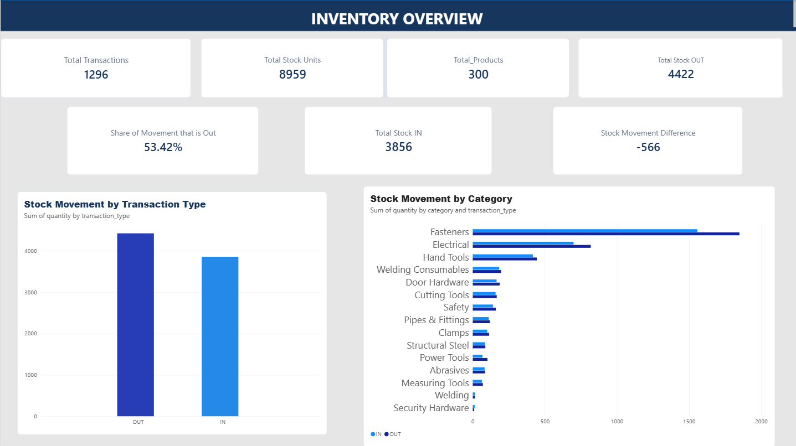

**Monthly Trend**

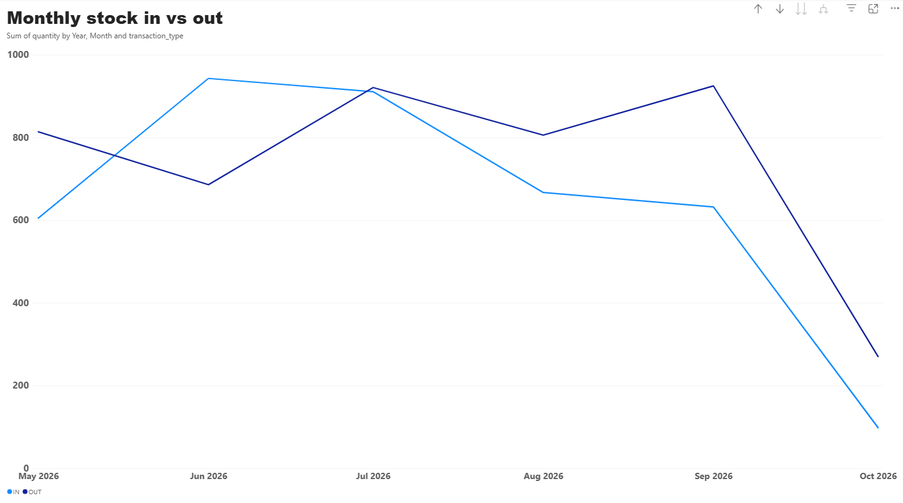

**Product Analysis**

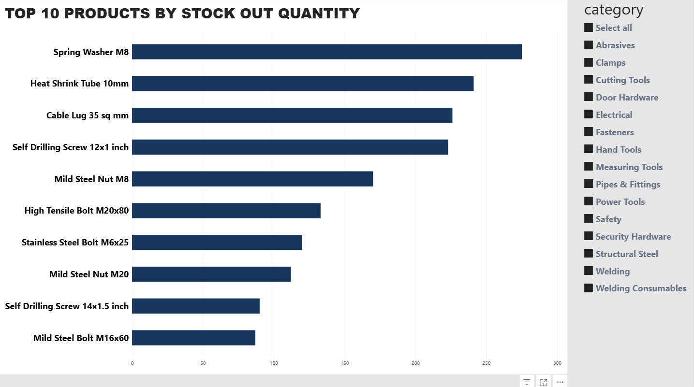

**Stock Risk Analysis**

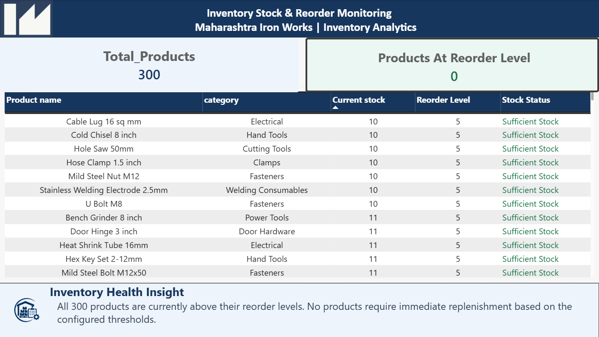

**Sales and Revenue**

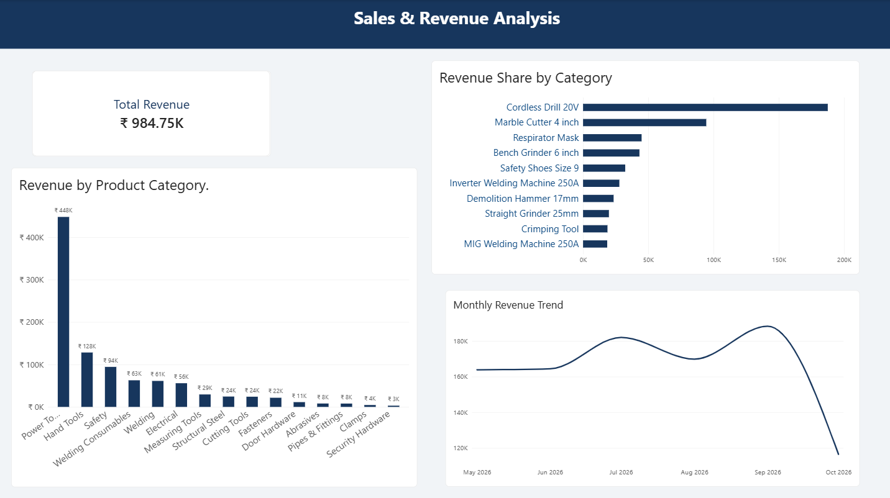

---

## 7. Project Structure

```text
maharashtra-iron-works-portfolio/
│
├── README.md
│
└── Maharashtra-Iron-Works-Portfolio/
    │
    ├── website/
    │   ├── admin.html
    │   ├── Index.html
    │   └── code.gs
    │
    ├── python/
    │   ├── make_simulated_data.py
    │   ├── products.csv
    │   └── transactions.csv
    │
    ├── MYSQL/
    │   └── 01 to 09 .sql files
    │
    ├── Power bi/
    │   └── final.pbix
    │
    ├── screenshots/
    │   ├── 01 to 05 dashboard images
    │   └── website/ (website and Google Sheets images)
    │
    └── documentation/
        ├── Project_Overview.md
        ├── Database_Documentation.md
        ├── PowerBI_Documentation.md
        ├── Setup_Guide.md
        └── Limitations_and_Future_Scope.md
```

---

## 8. Skills Demonstrated

- Inventory workflow design and QR-based product identification
- Google Apps Script web app development and Google Sheets integration
- HTML, CSS and JavaScript
- Python data generation (pandas, numpy)
- MySQL database design, querying and data validation
- Power BI dashboards, DAX measures and data modeling
- Business reporting and insight writing
- Technical documentation

---

## 9. Limitations and Future Scope

**Limitations**
- Transactions, cost prices and reorder levels used for analysis are simulated, so findings are illustrative.
- Revenue uses the current selling price, not the price at the time of sale.
- About six months of data cannot show full-year seasonality.
- Google Sheets suits one shop and modest volume, not a large business.
- The admin PIN in this version is checked in the browser. Production use needs server-side authentication and a security review of the deployment settings.

**Future improvements**
- Server-side login with role-based permissions
- Price stored on every transaction, and separate handling of admin corrections
- A more detailed audit log
- Automated low-stock alerts
- Demand forecasting and reorder-point suggestions
- A real database behind the website instead of Google Sheets

---

## 10. Documentation

More detail is in the `documentation` folder: project overview, database documentation, Power BI documentation, setup guide, and limitations and future scope.

---

**Author:** DEEP CHANDAK | deepchandak7@gmail.com

**Repository:** https://github.com/deep-chandak/maharashtra-iron-works-portfolio
